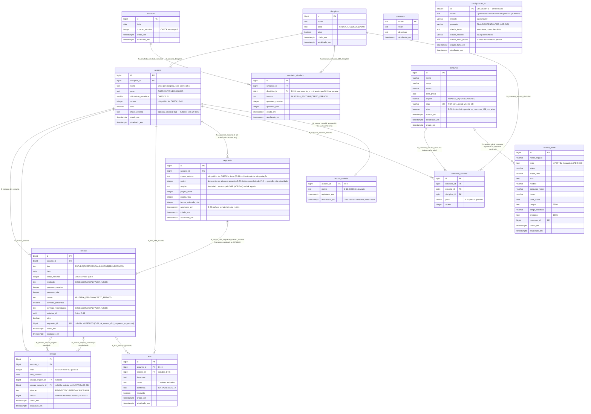

# DIAGRAMA ER

Visualização do schema de banco em Mermaid. **Não define nada** — é espelho
do que já existe nas migrações; a fonte de verdade de coluna, restrição e
índice é sempre `src/main/resources/db/migration/`, documentada por
`docs/SPRINT-1-BANCO.md` e pelos documentos técnicos das sprints que
alteraram o schema depois (`SPRINT-4-ESCADA` — `versao`; `SPRINT-7-METRICAS`
— D-46; `SPRINT-8-SIMULADO` — `simulado`/`resultado_simulado`;
`SPRINT-10-SEGMENTO` — `segmento`, `assunto.chave_externa`,
`sessao.segmento_id`). Se este diagrama e o schema real divergirem, o
schema real vence, e este arquivo está desatualizado — não o contrário.

| Campo | Valor |
|---|---|
| Versão | 2.5.0 |
| Data | 2026-10-17 |
| Status | Vigente |
| Subordinado a | `docs/SPRINT-1-BANCO.md`, `docs/SPRINT-4-ESCADA.md` (ADR-032), `docs/SPRINT-7-METRICAS.md` (D-46), `docs/SPRINT-8-SIMULADO.md` (D-13), `docs/SPRINT-10-SEGMENTO.md` (D-50 a D-53), `docs/SPRINT-18-CONCURSOS.md` (D-58), `docs/SPRINT-19-MATERIAL-AUTOMATICO.md` (D-64, D-65); `src/main/resources/db/migration/V1`, `V3`, `V5`, `V7`, `V8`, `V9`, `V12`, `V13` |

---

## Diagrama

## Notas de leitura

- `parametro` e `configuracao_ia` não aparecem com nenhuma linha de
  relacionamento — são configuração pura (`01_DOMINIO` §3), sem FK para
  nenhuma outra tabela.
- `lacuna_material` é a única tabela da Sprint 19 que guarda um fato: o estado
  do material (pronto, sem material, a preparar) é derivado dos segmentos, e
  segmento vence lacuna (D-65). Nada a apagar quando o material chega.
- `revisao` tem duas FKs distintas para `sessao` (`sessao_origem_id` e
  `sessao_cumpriu_id`): a sessão que gerou a revisão e a sessão que a
  cumpriu não são a mesma pergunta. D-06 amarra a segunda: só pode ficar
  nula se `situacao != 'CUMPRIDA'`.
- Nenhuma tabela tem coluna de fase (D-16). A fase do assunto é derivada em
  memória a partir de `revisao`/`sessao` — não existe aqui porque não deve
  existir. O mesmo vale para `simulado`/`resultado_simulado`: nenhuma FK
  para `assunto` — é assim que D-13 se garante, ausência como garantia
  (`03_INVARIANTES` §9), mesmo mecanismo de D-16.
- `resultado_simulado` é único por `(simulado_id, disciplina_id)` — um
  simulado não tem duas apurações da mesma disciplina. Higiene de dado, sem
  `D-xx` (a restrição não aparece no diagrama, que mostra só FK/PK).
- Todas as **9 tabelas** já existem no schema: as 5 de domínio original
  desde a Sprint 1, `simulado`/`resultado_simulado` desde a Sprint 8,
  `segmento` desde a Sprint 10. Ganhar entidade JPA é progresso de sprint
  separado: `disciplina`/`assunto` na Sprint 2; `sessao` na Sprint 3;
  `revisao` na Sprint 4; `erro` e `Simulado`/`ResultadoSimulado` na
  Sprint 7/8 (`docs/SPRINT-2-CADASTRO.md` §0) — `erro` e
  `simulado`/`resultado_simulado` tinham a **tabela** desde a Sprint 1, só
  ganharam entidade/service/controller bem depois.
- `fk_erro_assunto` virou `fk_erro_d46_assunto` na Sprint 7 (migração `V7`):
  a restrição já existia desde V1, sem identificador de regra — D-46
  formalizou o que faltava, sem mudar o schema em si.
- `segmento.chave_externa` e `assunto.chave_externa` são obrigatoriedade via
  `CHECK`, nunca `NOT NULL` nativo (mesmo padrão de D-41 em `assunto.ordem`)
  — é o que deixa o identificador da regra no nome da restrição
  (`03_INVARIANTES §9.1`); por isso o diagrama não marca essas colunas como
  `NOT NULL` mesmo quando obrigatórias.
- `fk_sessao_d51_segmento_mesmo_assunto` é **FK composta**
  `(segmento_id, assunto_id) → segmento (id, assunto_id)`, não uma FK
  simples — é o mecanismo que impõe "o segmento pertence ao mesmo assunto
  da sessão" sem checagem prévia no serviço. O Mermaid não representa FK
  composta como relação própria; a linha do diagrama mostra a cardinalidade,
  o nome completo do mecanismo está só no rótulo.

---

## Changelog

| Versão | Data | Mudança |
|---|---|---|
| 2.5.0 | 2026-10-17 | `V15`: `segmento.arquivado_em`, `lacuna_material.descartada_em` (D-66); D-50 vira índice único parcial sobre os segmentos ativos. `V14` só acrescentou colunas a `configuracao_ia` (provedor e assinatura do Claude, ADR-045) |
| 2.4.0 | 2026-10-17 | Sprint 18 (`V12`), que tinha ficado de fora: `concurso` (D-58), `concurso_assunto` (cobertura do edital, a única n:n) e `analise_edital`. Sprint 19 (`V13`): `concurso.slug` passa a `NOT NULL` (D-64), `configuracao_ia` e `lacuna_material` (D-65) |
| 2.3.0 | 2026-09-06 | Sprint 10 (`V9`): tabela `segmento` nova (`chave_externa` obrigatória e única — D-53 —, `ordem` única no assunto — D-50); `assunto.chave_externa` (opcional, único — D-52); `sessao.segmento_id` (nullable, só `ESTUDO` — D-51, via FK composta `fk_sessao_d51_segmento_mesmo_assunto`). Notas de leitura atualizadas para 9 tabelas |
| 2.2.0 | 2026-09-01 | `sessao.proxima_sessao_data`/`proxima_sessao_descricao` removidas (`docs/SPRINT-1-BANCO.md` v1.4.0) |
| 2.1.0 | 2026-08-31 | `sessao.previsao_reconstrucao`: `boolean` → `text` (V1, `docs/SPRINT-1-BANCO.md` v1.2.0) |
| 2.0.0 | 2026-08-31 | `simulado`/`resultado_simulado` adicionados (Sprint 8, V8); `revisao.versao` adicionado (ADR-032, V5, esquecido na v1.0.0); `fk_erro_assunto` renomeado para `fk_erro_d46_assunto` (V7); notas de leitura atualizadas para 8 tabelas |
| 1.0.0 | 2026-08-28 | Criado, a partir de `V1__tabelas.sql` e `V3__restricoes.sql` (schema fechado desde a Sprint 1) |
